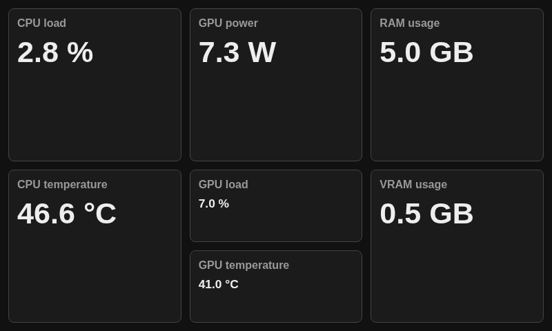

# Pulsedeck

Pulsedeck is a lightweight hardware monitor dashboard for AMD CPUs and GPUs. It is a web app designed to run on a Raspberry Pi screen, and it updates live without reloading the page.



> **Under development:** features and options may change.

## Configuration

Pulsedeck reads one YAML file that sets the grid and the widgets:

```
$HOME/.config/pulsedeck/config.yml
```

If the file does not exist, Pulsedeck writes this default file on the first request:

```yaml
# Size of the dashboard grid, in cells.
grid:
  columns: 3
  rows: 4

# Each widget has a provider and a placement.
# column and row start at 1. width and height are optional (default 1).
# type is optional: value (default) or line_graph. readings is optional for line_graph: number of past readings (default 60).
widgets:
  - provider: cpu_load # Provider id. Known ids: cpu_temperature, cpu_load, gpu_temperature, gpu_power, gpu_load, ram_usage, vram_usage
    column: 1
    row: 1
    height: 2
  - provider: cpu_temperature
    column: 1
    row: 3
    height: 2
  - provider: gpu_power
    column: 2
    row: 1
    height: 2
  - provider: gpu_load
    column: 2
    row: 3
  - provider: gpu_temperature
    column: 2
    row: 4
  - provider: ram_usage
    column: 3
    row: 1
    height: 2
  - provider: vram_usage
    column: 3
    row: 3
    height: 2
```

- `grid.columns` and `grid.rows` set the size of the grid.
- Each widget has a `provider` (known ids: `cpu_temperature`, `cpu_load`, `gpu_temperature`, `gpu_power`, `gpu_load`, `ram_usage`, `vram_usage`), a `column` and a `row`. Column and row start at 1.
- `width` and `height` are optional. The default is 1.
- `type` is optional. `value` (default) shows the current value. `line_graph` shows the last `readings` values as a line.
- `readings` is optional and only for `line_graph`. It is the number of past readings in the graph (2 or more, default 60). Pulsedeck reads one value each second. The graph starts empty when the page loads.
- A widget must be inside the grid.

Example of a `line_graph` widget:

```yaml
- provider: cpu_load
  type: line_graph
  readings: 120
  column: 1
  row: 1
  width: 2
  height: 2
```

The dashboard reloads itself when you change the config file.

## NixOS

Pulsedeck ships a NixOS module that runs the server as a `systemd` service.

1. Add the flake as an input and enable the module in your configuration:

   ```nix
   {
     inputs.pulsedeck.url = "github:JuanraCM/pulsedeck";

     outputs = { nixpkgs, pulsedeck, ... }: {
       nixosConfigurations.myhost = nixpkgs.lib.nixosSystem {
         system = "x86_64-linux";
         modules = [
           pulsedeck.nixosModules.default
           {
             services.pulsedeck = {
               enable = true;
               port = 9292;
               openFirewall = true;
             };
           }
         ];
       };
     };
   }
   ```

   If your configuration already uses an `imports` list, add `pulsedeck.nixosModules.default` there instead.

2. Apply the configuration:

   ```sh
   sudo nixos-rebuild switch --flake .#myhost
   ```

3. Open `http://<host>:<port>/` in a browser.

### Options

| Option | Type | Default | Description |
| --- | --- | --- | --- |
| `services.pulsedeck.enable` | bool | `false` | Run Pulsedeck as the `pulsedeck.service` systemd service. |
| `services.pulsedeck.port` | port | `9292` | TCP port the server listens on. |
| `services.pulsedeck.openFirewall` | bool | `false` | Open the port in the NixOS firewall. |
| `services.pulsedeck.user` | string | none (required) | Existing user that runs the service. The service reads `$HOME/.config/pulsedeck/config.yml` of this user. |

The service runs as the given user. The config file is `$HOME/.config/pulsedeck/config.yml` of that user. Pulsedeck writes the default file there on the first request. The user must exist (`users.users.<name>`). The module does not create the user. The service cannot bind ports below 1024.

```nix
users.users.alice.isNormalUser = true;
services.pulsedeck = {
  enable = true;
  user = "alice";
};
```

## Development

Start the development shell:

```sh
nix develop
```

Then run these commands inside it (or prefix them with `nix develop -c`):

- `bundle exec rackup`: start the server.
- `bundle exec srb tc`: run the type check.
- `bundle exec rubocop`: run the linter (add `-a` to autocorrect).
- `bundle exec rspec`: run the tests.
- `nix build`: build the package.
- `nix flake check`: run the NixOS VM test.
- `bundix`: regenerate `gemset.nix` after `Gemfile.lock` changes.
